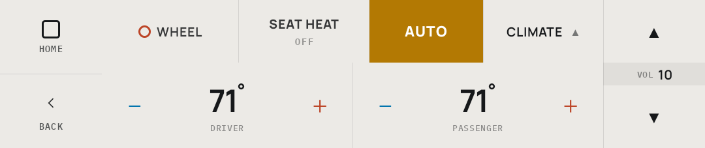
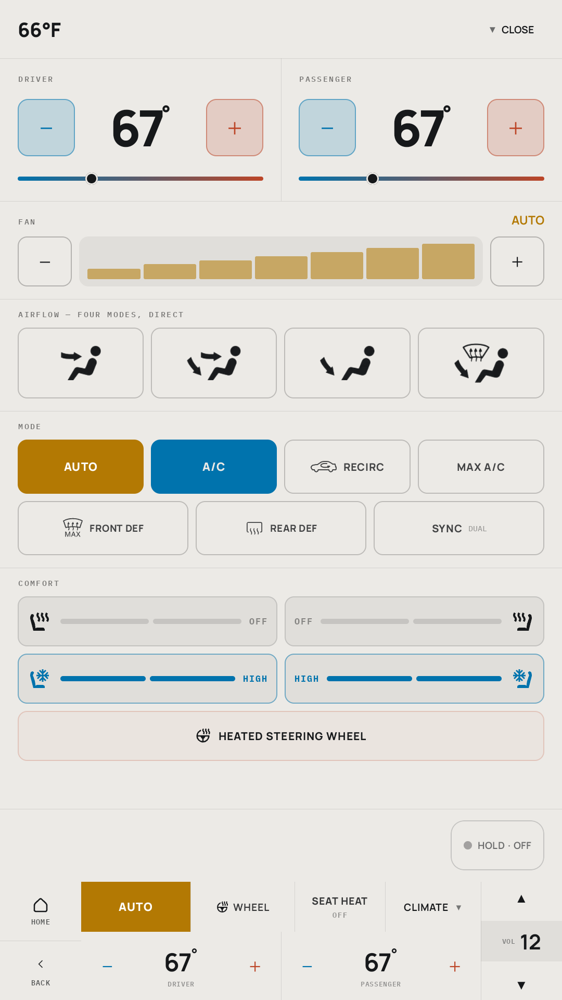
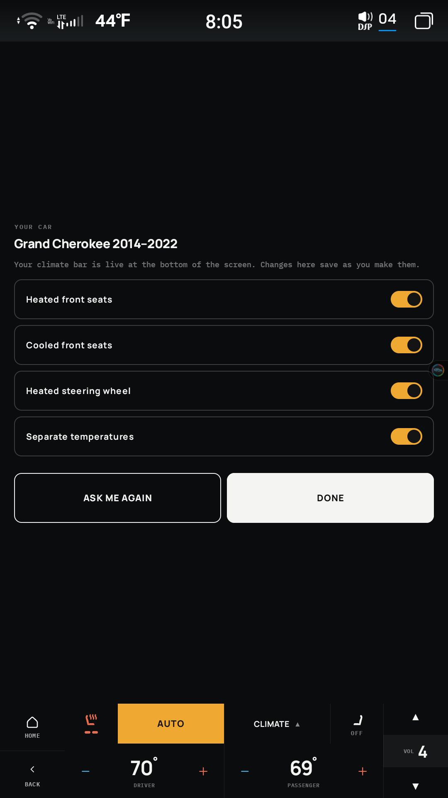

# wk2-climate

A replacement climate and navigation UI for the OEM `com.syu.air` bottom bar on
FYT/SYU **UIS7870** head units, built for a **Jeep Grand Cherokee WK2**.

The OEM bar packs roughly 24 same-weight targets into three rows, none taller
than ~70px, and none of it is adjustable. This replaces the resting bar with six
functions at a 96dp minimum target and moves everything else one tap away onto a
full-page climate view.

**Status: built and running in the vehicle.** Both screens are implemented,
reviewed and verified on hardware. 248 tests (176 bus, 60 ui, 12 tools).

---

## In the vehicle

The bar, replacing the factory one in place at `[0,1693][1080,1920]`:



The panel, opened by `CLIMATE` — note the bar is still visible along the bottom,
and its caret has flipped to point down, because the same control dismisses it:



And the one screen that is a normal activity, reached from the launcher icon.
Until the service is enabled it says so and deep-links to the toggle, because an
app cannot grant itself accessibility. After that it names the car the head unit
reports, asks the one-time setup questions, and then shows the answers as
switches that can be changed later:



All three are captured off a running vehicle, not a mockup or an emulator. In
the first two, every value shown is what the car reported: 66&#176;F outside
with both zones at 67, `SYNC` **un**lit because unlit means synced on this
vehicle (the signal is `DUAL`, so its polarity is inverted), `AUTO` owning the
fan, and seat cooling on `HIGH` both sides.

---

## What is built

| | |
|---|---|
| **Screen 2a — the bar** | Replaces the factory bar in place at `[0,1693][1080,1920]`. Nav, volume, a seat button at each end that shows that seat's heat or cool level and opens a menu for it, AUTO, both setpoints, and CLIMATE. |
| **Screen 1d — the panel** | Opens over app content at `[0,0][1080,1693]`, so the bar stays visible beneath it. Zones, fan, four airflow modes, seven mode tiles, comfort grid, hold-to-confirm power-off. |
| **`:bus`** | The vendor protocol behind a testable seam, with an adversarial fake that reproduces measured vehicle quirks. |

### Things the vehicle taught us that no document did

- **Registration notifies on *change*** and replays the vendor's cache;
  `IRemoteModule.get` is answered but always empty. So registration is the only
  read path, and signals the vendor has not learned yet arrive late — a bounded
  re-registration retry closes that gap.
- **`AUTO` toggles**, it does not merely set. The command table's `"AUTO on"`
  label described one observer's experiment, not the semantics.
- **`SYNC`'s signal is the vendor's `DUAL` flag**, so it is inverted: `1` means
  the zones are *independent*. Dual zone means two zones.
- **`MAX A/C`** drives the fan to 7, clears AUTO and forces recirculation.
- **The seat cycle is `0 -> 3 -> 1 -> 0`** — high before low, and state 2 is
  never visited.
- **There is no cabin-temperature signal at all**, confirmed by decompiling the
  vendor CANBUS app.
- **Callbacks from different modules arrive at the same time**, each on its own
  binder thread. A plain read-then-write of the shared state let one module's
  update erase another's. The retry hid this for climate signals, but the
  canbus id is sent once and never retried, so it left a fresh install
  stuck at "Reading your car…" in about one start in five.
- **When an app hides the navigation bar, the factory bar really goes**, and
  the app lays out over the whole screen. Our bar has to go with it, but an
  accessibility overlay sits above the navigation bar and so is never told
  about it: its own insets say "no navigation bar" whether one is showing or
  not. The display's insets do change, so the bar polls those.

Full write-ups, including the failed hypotheses, are in
[`docs/captures/`](docs/captures/).

### The one thing that needs a workaround

The vendor MCU service (`com.syu.ms`) force-stops **27 packages** on sleep
through a hidden `ActivityManager` API, skipping only names that match a regex
compiled from an asset inside its own APK — and `com.syu.air` is on that list,
which is why the factory bar survives. Being force-stopped also prunes an
accessibility entry at the framework level, and a stopped package has no process
left to re-add it.

So the `applicationId` is **`com.android.wk2climate`**, chosen to land inside
that regex. It is namespace squatting, deliberately, and
[the write-up](docs/captures/2026-09-09-syu-ms-force-stop.md) explains exactly
why nothing else works — a foreground service and a `deviceidle` exemption both
fail, because `forceStopPackage` ignores process importance entirely.

---

## Relationship to 7870-Projects

The reverse-engineering that makes this possible lives in
**[chrisuthe/7870-Projects](https://github.com/chrisuthe/7870-Projects)** and its
[wiki](https://github.com/chrisuthe/7870-Projects/wiki) — the SYU IPC framework,
the 87 `U_AIR_*` read codes, the WK2 command index table, and the screen-space
constraints. That repo is the protocol reference; this one is the app.

Nothing here needs root.

## How it works, in one paragraph

The vendor ships a three-interface AIDL framework (`com.syu.ipc`) that is **not
permission-gated** — an ordinary third-party app can bind it and both read and
write the vehicle bus. This app binds three modules (0 MAIN, 4 SOUND, 7 CANBUS),
subscribes to the climate state, and renders entirely from what the vehicle
reports. A tap dispatches a command and mutates nothing locally; the UI updates
when the vehicle reports the new value.

`com.syu.air` **keeps running underneath**. This is an alternative front end, not
a replacement service — a crash here must never leave a vehicle with no physical
HVAC controls unable to change its climate.

## Design

| Path | |
|---|---|
| [`docs/superpowers/specs/`](docs/superpowers/specs/) | The design spec — architecture, bus layer, reconciliation against the verified protocol, testing strategy, car-session checklist |
| [`design_handoff_system_navigation/`](design_handoff_system_navigation/) | The approved visual design. Authority on geometry, colour, type and spacing |

The design file (`System Navigation.dc.html`) renders in a browser — open it and
use the `2a` and `1d` badges to find the two approved screens. Earlier
explorations (`1a`, `1b`, `1c`, `1e`) are kept for context and are **not** built.

The panel is 1080x1920 at 160dpi, so **1px = 1dp** and every measurement in the
design is used directly as a dp value.

## Portability

Read codes (`U_AIR_*`) are universal across FYT UIS7870 units. **Command indices
are per-vehicle**, so the app reads the head unit's canbus id (module 7, read code
1000) and looks the car up in `vehicles.tsv`, which `tools/extract-vehicles.py`
builds straight from the `com.syu.air` APK. On first run it asks a few yes/no
questions — heated seats, cooled seats, heated wheel, separate temperatures —
and draws only what the car has. The answers can be changed later from the app
icon.

Cars on the same vendor profile as the WK2 (Durango, RAM, Wrangler, GMC,
Escalade and others) are also asked whether they have **rear climate**. A yes
adds a FRONT | REAR toggle to the climate page and a REAR page: rear
temperature, fan, airflow, REAR ON, REAR AUTO and LOCK REAR. Those commands come
from FYT's own climate screen rather than the bar
([decode](docs/captures/2026-10-28-pa-rear-climate.md)) and have not yet been
tried on a car that has rear climate — the WK2 does not.

Only cars whose vendor profile sends commands exactly the way the WK2's does are
driven: the PA canbus family, 60 ids across Jeep, RAM, Dodge, Chrysler, GM and
Ford. Every other car is left alone and keeps the factory bar. The list is on
[wiki: Supported Vehicles](https://github.com/chrisuthe/7870-Projects/wiki/14-Supported-Vehicles);
only the WK2 Grand Cherokee has been tested on a real vehicle.

## Install

Builds are published as
[GitHub pre-releases](https://github.com/chrisuthe/wk2-climate/releases). The
easiest way to install them and get updates is [Obtainium](https://obtainium.imranr.dev/).
On the head unit, with Obtainium installed, open:

**[Add WK2 Climate to Obtainium](https://apps.obtainium.imranr.dev/redirect?r=obtainium://app/%7B%22id%22%3A%22com.android.wk2climate%22%2C%22url%22%3A%22https%3A%2F%2Fgithub.com%2Fchrisuthe%2Fwk2-climate%22%2C%22author%22%3A%22chrisuthe%22%2C%22name%22%3A%22WK2%20Climate%22%2C%22additionalSettings%22%3A%22%7B%5C%22includePrereleases%5C%22%3Atrue%2C%5C%22apkFilterRegEx%5C%22%3A%5C%22%5Ewk2-climate-.%2A%5C%5C%5C%5C.apk%24%5C%22%2C%5C%22allowedSigningCertHashes%5C%22%3A%5C%2206%3A70%3A58%3A54%3A82%3ABF%3AF5%3A46%3A98%3A5E%3AE7%3AEA%3AE3%3A88%3AF9%3A43%3A72%3A96%3AA6%3AD5%3A8A%3AE5%3A1B%3A0C%3A0F%3A54%3A96%3AB3%3A00%3AA1%3AFD%3A0A%5C%22%7D%22%7D)**

It goes through Obtainium's redirect page and sets up three things that pasting
the repository URL into Obtainium does not:

- **Pre-releases are included.** Every build so far is one; without this,
  Obtainium finds no releases.
- **The APK is picked by name**: `wk2-climate-<version>.apk`.
- **The signing certificate is pinned** (SHA-256
  `06:70:58:…:A1:FD:0A`). Obtainium refuses an APK signed with any other key.

Then open WK2 Climate from the launcher. It walks through enabling the service
under Accessibility and the setup questions.

Installed this way, Android does not block the Accessibility toggle. Installed
by opening the APK from a browser or file manager, it does: the toggle is greyed
out as a "restricted setting" until you open **Settings → Apps → WK2 Climate**,
choose **⋮ → Allow restricted settings**, and try again.

On a head unit with Google Play, Play Protect may say **Unsafe app blocked**,
because the app targets Android 13 — the head unit's own version — on purpose.
Tap **More details → Install anyway**.

<details>
<summary>What the link contains</summary>

```json
{
  "id": "com.android.wk2climate",
  "url": "https://github.com/chrisuthe/wk2-climate",
  "author": "chrisuthe",
  "name": "WK2 Climate",
  "additionalSettings": "{\"includePrereleases\":true,\"apkFilterRegEx\":\"^wk2-climate-.*\\\\.apk$\",\"allowedSigningCertHashes\":\"06:70:58:54:82:BF:F5:46:98:5E:E7:EA:E3:88:F9:43:72:96:A6:D5:8A:E5:1B:0C:0F:54:96:B3:00:A1:FD:0A\"}"
}
```

URL-encoded after `obtainium://app/`. A new signing key means a new link.
</details>

## Safety

This touches the climate control of a vehicle with no physical HVAC controls.
All development was done on a stationary, parked car. Command index **16** turns
the climate system off; indices **12** and **15** are macros that force
recirculation on and temperatures to a minimum sentinel.

## Licence

Apache 2.0. See [LICENSE](LICENSE).
